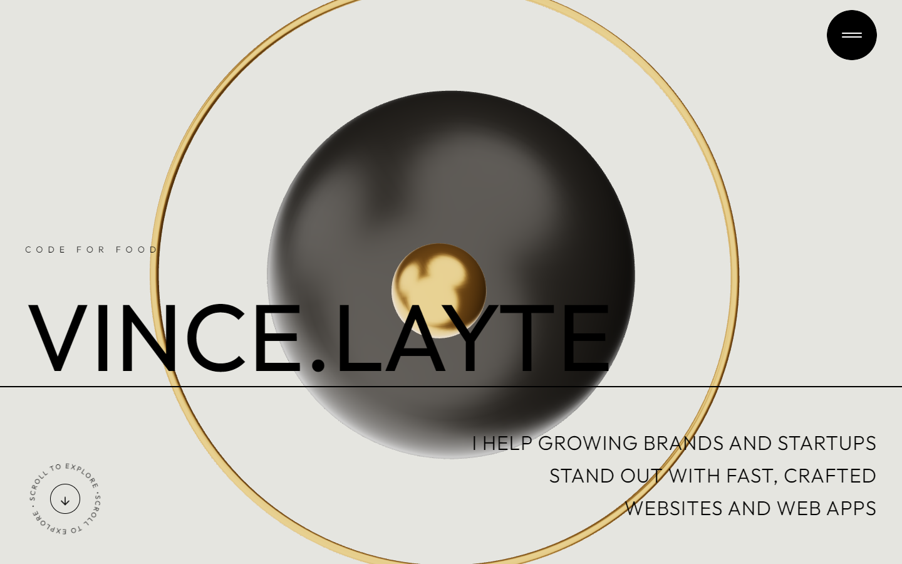
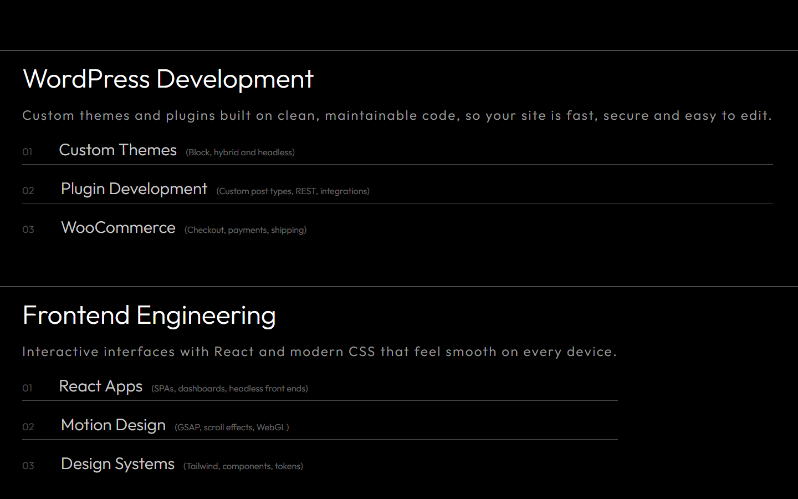
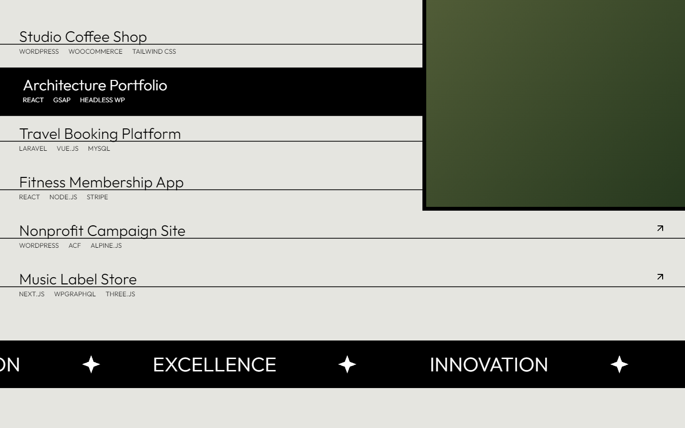
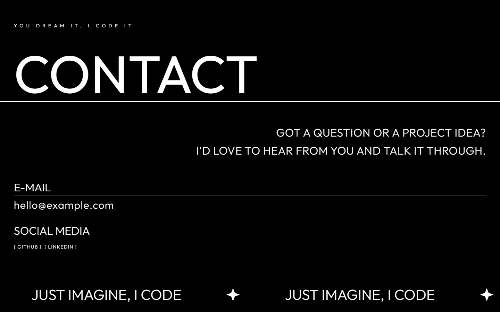
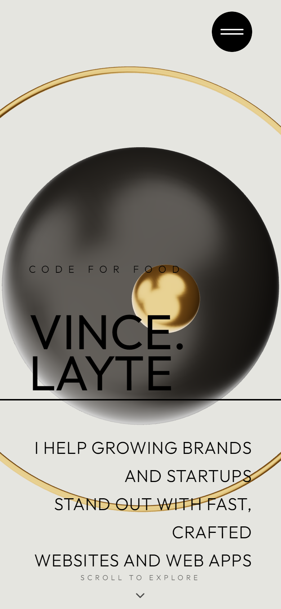
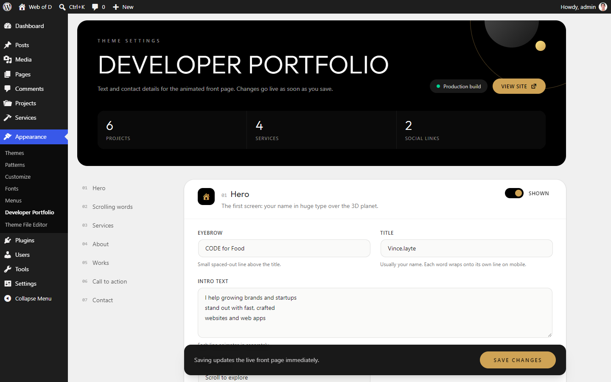
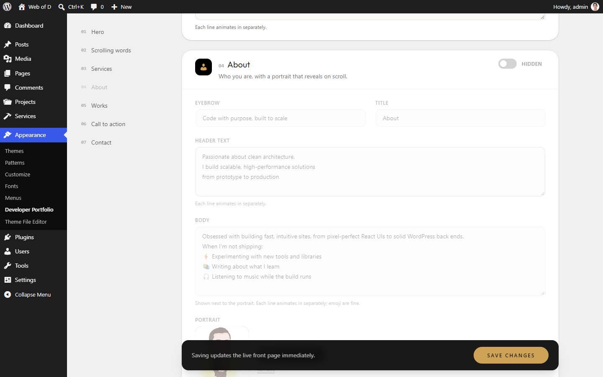
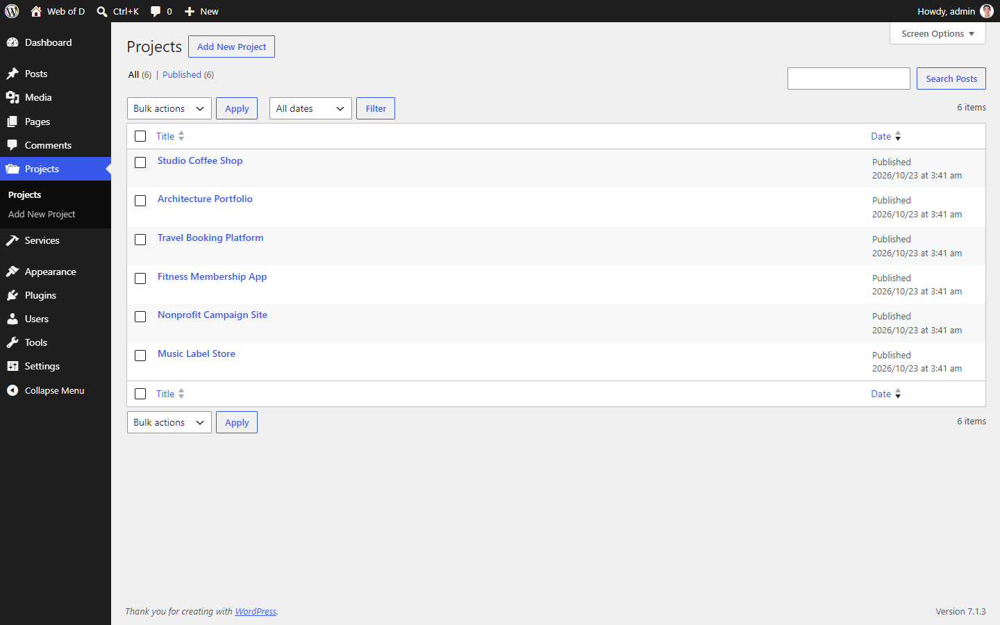
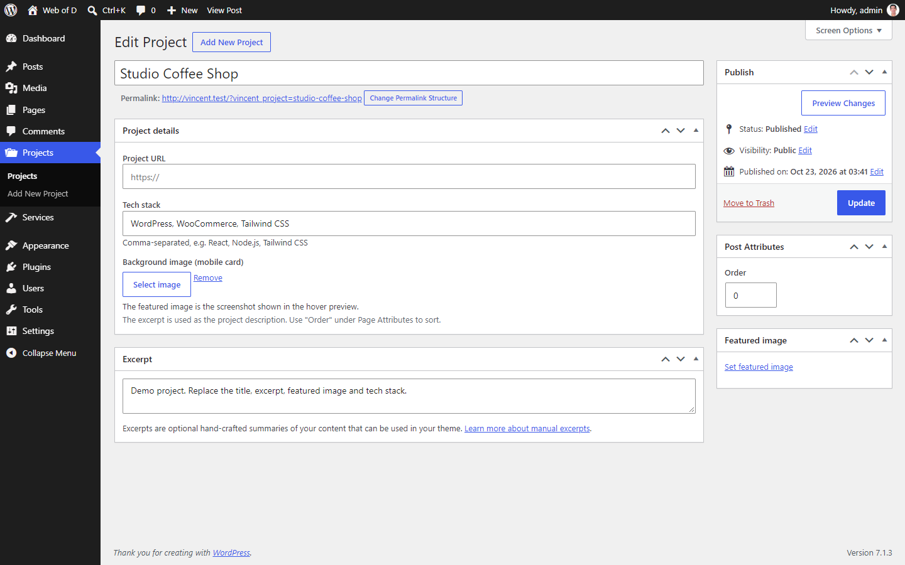

# Developer Portfolio

Developer Portfolio is an animated one-page portfolio theme for WordPress. The front page is a **React** app with GSAP scroll animations, Lenis smooth scrolling and a **3D planet** built with React Three Fiber, styled with Tailwind CSS 4. All of its content comes from WordPress, so you edit everything in wp-admin and never touch code. Other pages, posts and 404s use plain PHP templates in the same style.

- **Requires:** WordPress 6.5+, PHP 8.0+
- **Plugins:** none required
- **Version:** 1.0.0

## Screenshots

<!--
  Add images to docs/screenshots/ using these filenames, then remove this comment's
  opening and closing markers so they render. Suggested size: 1440px wide (desktop), 390px (mobile).

<p align="center">
  
</p>

| Services | Works |
|---|---|
|  |  |

| Contact | Mobile |
|---|---|
|  |  |

### Dashboard

| Settings page | Section toggles |
|---|---|
|  |  |

| Projects | Edit project |
|---|---|
|  |  |
-->

_Screenshots coming soon._

## Features

### Front page
- **Hero:** your name in huge type over a slowly floating 3D planet with a gold moon and ring, plus a "scroll to explore" cue.
- **Scrolling words:** big words that drift sideways as you scroll, separated by gold dividers.
- **Services:** cards that stack on top of each other as you scroll, each with numbered sub-items.
- **About:** a portrait that reveals with a wipe animation, next to text that animates in line by line.
- **Works:** a project list where hovering a row shows a floating preview image that follows the cursor. On mobile, each project shows its image inline.
- **Call to action:** a quote held in place briefly between two marquees that speed up while you scroll.
- **Contact:** email, phone and social links, with a marquee along the bottom.
- **Menu:** a full-height slide-in menu that links only to the sections you've switched on.
- **Loading screen** with a progress bar while the 3D scene loads.

### Content management
- **Projects** and **Services** have their own menus in wp-admin, ordered by the **Order** field.
- **Appearance → Developer Portfolio** holds every heading, text block, contact detail, social link and marquee text on one settings page.
- **Show/hide switch per section:** hidden sections disappear from the page and from the menu, and their content is kept for later.
- Images come from the Media Library. Anything without an image yet gets a gradient placeholder.
- Demo services and projects are created on first activation, so the page isn't empty.

### Details
- Long titles wrap after punctuation (`vince.layte` → `VINCE.` / `LAYTE`) and shrink to fit if needed.
- With **reduced motion** turned on, smooth scrolling and the scroll cue's spinning and bobbing are turned off.
- Always opens at the top of the page, even after a reload.
- A `<noscript>` fallback renders the content as plain HTML.
- The settings page uses its own scoped Tailwind build (`tw:` prefix, no base reset), so it doesn't restyle the rest of wp-admin.

## Installation

### From a release zip
1. Download `dev-portfolio-vX.Y.Z.zip` from the [Releases](../../releases) page, or build it yourself with `npm run bundle`.
2. In WordPress, go to **Appearance → Themes → Add New → Upload Theme**, upload the zip and activate it.

### From source
```bash
cd wp-content/themes
git clone https://github.com/slightgrey/dev-portfolio.git
cd dev-portfolio
npm install
npm run build         # builds the front page and stylesheets into dist/
```
Then activate **Developer Portfolio** under **Appearance → Themes**.

The front page works under both **Settings → Reading** options. To also have a blog, choose *A static page* and pick a Posts page.

## Configuration

### Appearance → Developer Portfolio

| Section | What you can edit |
|---|---|
| **Hero** | Eyebrow, title (your name), intro text, scroll hint text |
| **Scrolling words** | Rows of words. Separate words in a row with `\|`. |
| **Services** | Eyebrow, title, text. The cards themselves are under **Services**. |
| **About** | Eyebrow, title, header text, body, portrait |
| **Works** | Eyebrow, title, text. The list itself is under **Projects**. |
| **Call to action** | Values marquee, bottom marquee text, quote (allows `<br>`, `<em>`, `<strong>`, `<span class="text-gold">`) |
| **Contact** | Eyebrow, title, text, email, phone, marquee text, social links (`Name \| https://url`, one per line) |

Every section has a **Shown / Hidden** switch. Multi-line text fields animate in one line at a time on the front page.

### Projects

| Field | Used for |
|---|---|
| Title | Project name |
| Excerpt | Description |
| Featured image | Screenshot in the hover preview |
| Background image | Backdrop behind the screenshot on mobile |
| Project URL | Makes the row a link (opens in a new tab) |
| Tech stack | Comma-separated, e.g. `React, Node.js, Tailwind CSS` |
| Order | Position in the list |

### Services

| Field | Used for |
|---|---|
| Title | Card heading |
| Excerpt | Card description |
| Items | One per line: `Title \| description` |
| Order | Position in the stack |

## Development

```bash
npm run dev             # Vite dev server with hot reload (writes a `hot` file)
npm run build           # production build into dist/
npm run lint            # ESLint
npm run bundle          # build and package dev-portfolio-vX.Y.Z.zip
npm run version:patch   # or version:minor / version:major
```

While `npm run dev` runs, WordPress loads assets from `http://localhost:5173`. Stop it with **Ctrl+C**, which removes the `hot` file and switches back to `dist/`. If the process is killed another way, delete `hot` by hand.

Releases: bump the version (this updates `style.css`, `functions.php` and `package.json`), commit, then run `npm run bundle`.

| Path | Contents |
|---|---|
| `functions.php` | Theme bootstrap |
| `inc/` | PHP: `post-types.php` (Projects, Services), `options.php` (settings page), `data.php` (content passed to React), `vite.php` (asset loading), `seed.php` (demo content), `setup.php` |
| `front-page.php` | React mount point and no-JS fallback |
| `*.php` | Fallback templates for pages, posts, archives and 404 |
| `src/` | React app: `sections/`, `components/`, `lib/data.js`. CSS: `index.css` (front page), `site.css` (other templates), `admin.css` (settings page), `theme.css` (shared tokens). |
| `scripts/` | `bundle.js` and `version.js` |
| `assets/` | Admin media-picker script |

WordPress outputs all front-page content as `window.vincentData`, built by `vincent_get_portfolio_data()` in `inc/data.php`.

## Credits

The design and animations are based on [awwwards-portfolio](https://github.com/Ali-Sanati/awwwards-portfolio) by Ali Sanati. None of its images, fonts or 3D model are included. This theme uses the [Outfit](https://fonts.google.com/specimen/Outfit) font (SIL Open Font License), and its planet is built in code.

## License

[GPL-3.0](LICENSE)

---

Built by [Web of D](https://vincelayte.me/).
